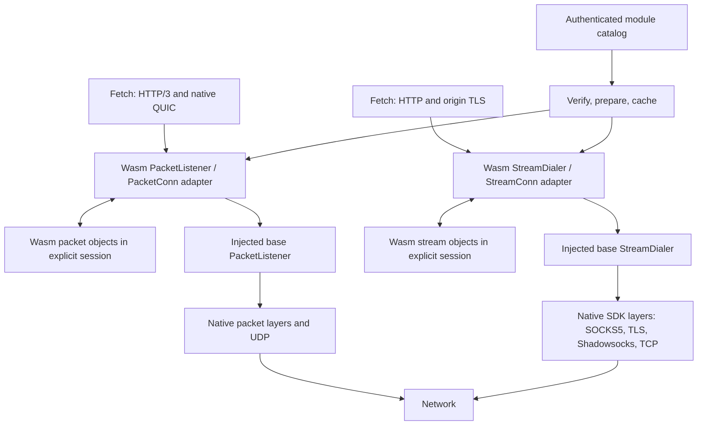

# Design proposal: dynamically supplied Outline stream and packet transports

Date: 2026-09-24. Desktop and mobile are design targets; fetch is the first proof of concept. The architecture below remains a proposal. A narrower [fetch spike is now implemented](spike-results.md); its [ABI reference](docs/abi.md) is the source of truth for executable behavior.

## Recommendation and boundaries

Implement Outline `transport.StreamDialer` and `transport.PacketListener` adapters in the experimental `x/wasm` package. Embed wazero in the Go host with an Outline-specific ABI; WATER interfaces are excluded. One linked Wasm artifact exposes multiple named constructors that create independently configured factory objects, each creating its own connection objects. The guest implements protocol logic; Go performs I/O through injected SDK interfaces. Register `wasm:` in both configuration registries. New protocols are artifact/constructor selections, not new parsers compiled into the application.

The [object model](object-model.md) defines artifact versus session versus object, dependency sharing, explicit lifetimes and composition across layers. It replaces the earlier one-module-instance-per-connection proposal. No mutable global transport state or global initialization selects an active dialer.

Ship the runtime, host capabilities, verifier, and configuration integration once. Thereafter a provider can distribute compatible modules and select them through authenticated configuration. This cannot retrofit clients that lack the runtime, add capabilities outside the shipped ABI, or remove mobile distribution constraints. A protocol needing a cooperating server also requires provider-side deployment.

V1 has two required profiles: reliable, ordered streams backed by one underlying SDK stream per connection; and multi-destination packet listeners backed by one underlying SDK `net.PacketConn` per listener instance. Include handshakes, ongoing stream framing, and datagram transformations. Defer QUIC implemented inside Wasm, stream accept/listen APIs, raw sockets, cross-profile transports such as streams over packets, and arbitrary socket options. Native QUIC above the Wasm packet listener is in scope. Exact TCP packet boundaries are not expressible through a generic stream.

## Existing SDK integration points

The inspected SDK exposes `StreamDialer.DialStream(context.Context, string) (StreamConn, error)`. A `StreamConn` includes `net.Conn` plus `CloseRead` and `CloseWrite`. `configurl.ExtensibleProvider.RegisterType` registers factories; each receives `Config.URL` and `Config.BaseConfig`. `ParseConfig` already handles pipe-separated URLs. These interfaces require no root-module change. [SDK sources](sources.md#outline-sdk)

The packet adapter implements `PacketListener.ListenPacket(context.Context) (net.PacketConn, error)`, retaining `ReadFrom` / `WriteTo` and address-aware multi-peer operation. This is not a connected `PacketDialer` or a stream accept loop. [Packet interfaces](https://github.com/OutlineFoundation/outline-sdk/blob/main/transport/packet.go)

Fetch constructs a provider container, creates a stream dialer for HTTP/1 and HTTP/2, and installs it through `http.Transport.DialContext`. HTTP/3 uses the packet-listener registry and supplies the resulting `net.PacketConn` to native QUIC. All three are required proof paths. Module preparation needs its own bounded context because the current HTTP timeout does not cover constructing a transport. [Fetch source](https://github.com/OutlineFoundation/outline-sdk/blob/main/x/tools/fetch/main.go)

## Runtime and reuse decision

| Candidate | Fit | Proposed decision |
|---|---|---|
| wazero embedded in Go | Pure Go, no CGO dependency; interpreter and compiler engines; host functions | Default runtime |
| Wasmtime Go binding | Alternative engine with native-library integration | Reconsider if required features or measured performance justify added build complexity |
| Browser Wasm or a separate executable | Does not directly fit an embedded Go SDK on mobile | Outside V1 |

Wazero's pure-Go implementation and engine choices are documented by its [project](https://github.com/wazero/wazero). Wasmtime's [Go binding](https://github.com/bytecodealliance/wasmtime-go) introduces a native runtime integration. These are architectural choices, not measured performance rankings.

Start with wazero's interpreter for reproducibility and the mobile baseline. Exercise the compiler separately on supported desktop/Android targets. Do not depend on dynamically generated native code on iOS. Test the actual gomobile embedding, not just a standalone Go binary.

Use an explicitly owned manager/runtime with a bounded compiled-artifact cache. A caller-owned BuildScope holds one session per artifact for a trusted strategy graph; each session is a Wasm execution instance with several independently configured factories and connections. Different scopes can use separate sessions of the same prepared artifact. Protocol state belongs to objects, never an ambient current configuration. PacketConn objects persist across destinations. Instantiate without inherited files, environment, or stdio; permit only declared imports. Prefer a small core-Wasm ABI; WASI is optional toolchain support, not the networking contract.

Wazero provides memory-page limits and `WithCloseOnContextDone`; cancellation through the latter closes the instance. Its module configuration can disable automatic `_start` invocation. These controls need to be configured explicitly. [Runtime API](https://github.com/wazero/wazero/blob/main/config.go)

Decision: the user has ruled out WATER's interfaces as inappropriate. Define the ABI around Outline's stream and packet contracts directly; there is no WATER adoption spike or compatibility requirement. Its research remains prior art only.

## Composition



`wasm:module=demo-v1&component=stream.identity` selects a constructor and uses the container's base dialer. In a default container that is TCP; applications can supply a VPN-aware/protected base dialer instead. Guest-requested connections must always use that injected base.

`socks5://127.0.0.1:1080|wasm:module=demo-v1&component=stream.identity` builds:

```text
Wasm(SOCKS5(TCP))
```

The rightmost configuration is the outermost dialer. The guest can ask its base to connect to the requested destination or to a configured relay allowed by host policy. DNS follows that base's behavior; the host must not silently resolve a proxy-bound destination through the local resolver.

The reverse order, `wasm:module=demo-v1&component=stream.identity|socks5://127.0.0.1:1080`, builds `SOCKS5(Wasm(TCP))`: the Wasm transport now carries the SOCKS handshake to the SOCKS server. These are different protocols on the wire, not interchangeable spellings.

Wrapping a native layer also changes which bytes the guest observes. HTTPS in fetch still has origin TLS above this stack. A Wasm layer below native TLS cannot directly edit the TLS plaintext; a stream splitter does not guarantee wire packet boundaries when another buffering layer follows it.

For packets, `wasm:module=demo-v1&component=packet.identity` selects a packet constructor from the same artifact and wraps the injected base `PacketListener` (UDP in a default container). Prefixing it with `socks5://127.0.0.1:1080|` builds `WasmPacketListener(SOCKS5PacketListener(...))`; payload datagrams use the base listener's encapsulation/routing. Prelude packets and the datagram they precede use the same base packet connection.

The profile comes from the requested SDK interface, not from guessing at bytes. The artifact catalog declares each constructor's output interface and parameter schema; reject a constructor/type mismatch before constructing its base. The module can include both profiles. V1 only composes matching interfaces, although native bases may themselves use mixed transports internally. The same artifact can supply several layers, including layers separated by native code; see the concrete example in [object-model.md](object-model.md#composition-at-different-layers).

## Proposed execution model and guest ABI

The most important choice is to separate guest execution from waiting for the network. Do not put a mutex around guest `Read` and `Write` functions that perform blocking host I/O: a read can then prevent the write needed to elicit its response. Likewise, do not concurrently enter shared guest state without an explicit memory/concurrency model. Wazero documents restrictions on concurrent calls through the same function object. [Function API](https://github.com/wazero/wazero/blob/main/api/wasm.go)

Use one Go dispatcher per explicit session and short guest calls, scheduled fairly among object handles. The guest consumes object-addressed events and emits actions. Host workers execute blocking base operations outside guest execution. Another Wasm layer reached through a native base may be in the same session: enqueue its work after the current call returns, never recursively enter the guest or hold its lock across base I/O. Keep both directions runnable; idle sessions sleep on Go channels.

Proposed ABI version: `outline_transport_v1`, with explicit `stream` and `packet` profiles and shared buffer, lifecycle, timer, error, and capability conventions. This is a contract outline; binary layouts and numeric values are an implementation milestone. Here, “component” means an Outline plugin compiled to a core Wasm module; V1 does not require the WebAssembly Component Model, WIT, or WASI Preview 2.

| Surface | Proposed responsibilities |
|---|---|
| Guest exports | ABI/catalog discovery, session create/close, named constructor invocation returning a factory handle, dial/listen returning pending child handles, object-addressed step/release, bounded buffer operations |
| Stream events/actions | Dial completion; network data/EOF/error; application write; write completion; dial base; send/deliver bytes; acknowledge write progress; half-close |
| Packet events/actions | Listen completion; application datagram plus destination; network datagram plus source; send completion; open base listener; send/deliver whole datagram plus address; acknowledge/drop application datagram |
| Shared events/actions | Writable credit; timer; cancellation; declare ready; request timer; close; fail |
| Minimal host imports | Bounded secure randomness and monotonic time; optional rate-limited diagnostic codes |

Use wasm32 offsets and lengths into exported linear memory, explicit message tags and error codes, and versioned structures. No Go pointers, OS descriptors, or language-specific object layouts cross the boundary. Every method/event/action carries its session-scoped typed object handle and operation ID. The explicit session arena uses generation counters to reject stale handles. The host validates offsets, counts, types and base capabilities. Copy outgoing payloads before asynchronous work; never retain views across memory growth or another call. Define buffer ownership and reuse.

A documented guest helper library and complete examples are required deliverables. Start with one supported, pinned Rust core-Wasm toolchain and a small guest binding; add C or TinyGo only with verified build recipes. Demonstrating ordinary Go networking code compiled to Wasm is a separate task; neither Wasm nor WASI automatically supplies the SDK's socket abstraction. See [component developer guide](component-developer-guide.md).

V1 permits one underlying stream per stream connection object or one underlying packet connection per PacketConn object; factories may create many such children. The stream child receives the logical destination independently from its relay address; the packet child receives addresses on each datagram. Base capabilities are explicitly bound to the factory and its children. Composition and ownership graphs are acyclic and depth-bounded.

## Stream connection contract

- `DialStream` completes only on guest `READY`, after its handshake. The dial context bounds setup; after success, the connection has a separate lifetime. Canceling the old dial context must not kill an established stream.
- Serialize guest execution while allowing concurrent application `Read` and `Write`. Limit outstanding I/O per direction and use bounded queues with backpressure. Do not block the dispatcher while enqueuing an action; use credit/completion events.
- `Read` must handle partial output, buffered bytes followed by EOF, and errors after data. A nonempty read cannot repeatedly report `(0, nil)`.
- Define application `Write` progress separately from wire bytes: framing changes sizes. Acknowledge only accepted input bytes, own a copy of them until processed, and prohibit later transmission of an unacknowledged suffix after a partial return. If a timeout interrupts a frame in an unrecoverable state, fail that connection instead of replaying data. Document whether a successful write means bounded-buffer acceptance or underlying-write completion before freezing the ABI.
- Keep `SetDeadline`, `SetReadDeadline`, and `SetWriteDeadline` in the host, including deadline changes while calls are blocked. Normal I/O timeouts must not be implemented as cancellation of a Wasm call; that destroys the instance. Resettable read timeouts should remain usable; unrecoverable protocol errors are terminal.
- Distinguish `CloseRead`, `CloseWrite`, and `Close`. A write-side close allows guest framing/trailers to drain within a bounded shutdown period before base half-close. `Close` aborts that connection's pending I/O and releases its object/host handles; sibling objects remain usable. Closing one direction does not automatically close the other. A guest cleanup call that exceeds its execution budget terminates the shared session and fails all objects in it; it cannot be forcibly isolated to one object.
- Report address metadata consistently: base local address and a logical remote address describing the requested target. Keep relay identity separately for diagnostics.
- Map guest traps, invalid output, unsupported imports, and budget violations to typed Go errors and cleanup. No silent direct-network fallback.

## Packet listener contract

`ListenPacket(ctx)` on a factory creates a packet child object and opens its injected base. Return on child `READY`; this denotes a usable local packet connection, not a handshake with every future peer. Setup cancellation releases that child's resources. A successful connection has its own lifetime and survives cancellation of the setup context. Subsequent calls create independent children from the same listener factory.

- Each application `WriteTo` supplies exactly one logical datagram and its destination; each delivered `ReadFrom` result supplies one logical datagram and its source. The guest can emit multiple wire datagrams, add a prelude, encapsulate, or deliberately drop a datagram, with an explicit completion. It must reassemble protocol fragments before delivering a logical datagram. Empty datagrams are valid; zero bytes do not mean EOF.
- Use operation IDs to associate completions with input datagrams. Success acknowledges the original logical length, not encoded length or the sum of prelude bytes. A successful intentional drop must consume the datagram explicitly. Treat underlying short writes as failures; never send a leftover suffix as a second datagram. Define acceptance, cancellation and errors after partial multi-datagram emission without promising atomic network delivery or automatically replaying a datagram.
- Serialize typed addresses: IPv4/IPv6 bytes, numeric port, IPv6 zone, or a domain variant when supported. Keep logical source/destination distinct from relay addresses. Reconstruct Go address values appropriately; QUIC receives IP-based `*net.UDPAddr` values. The host must not introduce implicit DNS resolution. Fetch currently resolves its HTTP/3 destination before QUIC; this design alone does not change that behavior.
- Preserve packet boundaries through buffering. On a caller buffer smaller than a decoded datagram, copy the prefix and discard that datagram's remainder; do not return it on the next read. Define and test the adapter's truncation reporting. Host receive buffers must accommodate the declared maximum wire datagram within a hard cap; reject oversize input/output rather than presenting truncated wire bytes as a complete guest event.
- Support concurrent reads and writes, deadline updates/reset, `LocalAddr`, and `Close` unblocking pending operations. Packets have no stream half-close or stream EOF. A peer-specific malformed packet must not automatically kill unrelated peers; distinguish drop, operation failure, and instance-fatal errors.
- Preserve the base socket across destinations and per-peer protocol state. Bound per-peer state and expiry, packet counts as well as queued bytes (including empty packets), output expansion, reassembly bytes/time, and send rate. Define overflow/drop behavior. One noisy peer must not monopolize the dispatcher.
- Expose the portable `net.PacketConn` contract first. Do not forward raw socket, batch-I/O, or other optional interfaces in ways that bypass the guest. Measure native QUIC's generic packet path and any lost optimizations before claiming performance parity.

The SDK defines the listener as a factory for a multi-destination packet connection; Go's PacketConn contract supplies concurrency, addressing, deadline, and close requirements. The guest-specific framing, truncation, and policy choices above are proposed adapter behavior. [SDK packet API](https://github.com/OutlineFoundation/outline-sdk/blob/main/transport/packet.go), [Go PacketConn](https://pkg.go.dev/net#PacketConn)

## Component-developer documentation

Ship package-level documentation linking a full author guide, ABI reference, guest bindings, and reproducible stream and packet examples. Explain writing handlers, declaring capabilities, configuring a component, building the accepted core-Wasm artifact, verifying imports/exports and limits, exercising it in fetch, debugging traps, and distributing a versioned artifact. Build and run the documented examples in CI. Neither adapter is complete until an independent developer can follow those instructions. The [draft guide](component-developer-guide.md) defines the workflow and documentation acceptance criteria.

## Resource and trust model

The module controls bytes and can observe the traffic handed to this layer. Sandboxing prevents arbitrary host access; it does not make a provider's transport trustworthy or confer encryption. Keep origin TLS validation in place. Give modules only the credentials their protocol actually needs, via memory configuration rather than URLs or logs.

Proposed experiment limits: 4 MiB artifact download, 64 KiB constructor configuration, 16 MiB guest linear memory per session, 256 KiB host queue capacity per connection object, one base stream or packet connection per child, bounded object/timer counts and a manager-wide session cap. Also cap aggregate session/manager queue memory. Packet policy needs datagram-size/count, peer-count, expansion and reassembly bounds. Tune these for multi-constructor artifacts; they are not production defaults. Guest memory limits do not cover all process memory and cannot impose hard isolation between objects sharing one linear memory.

Bound each guest execution slice, initialization, and cleanup with a runtime-enforced wall-clock limit. Also cap action counts and sustained scheduling rate so many short calls cannot monopolize CPU. Measure on the ZimaBlade and real phones before choosing values; wall time is not an instruction-count/fuel guarantee. All host imports must themselves be bounded. Cancellation cannot repair a Go callback that never returns.

Normal errors and cancellation are object-scoped. Runtime execution-budget termination or a guest trap is session-fatal in V1; all objects in that session fail and release their I/O. Objects share the artifact/session trust boundary, not separate sandboxes. Applications choose separate sessions when they need separate mutable memory and failure isolation, while reusing prepared artifact code.

Reject unsupported features, ABI versions, imports, and excessive declared resources before activation. Audit module initialization as well: clearing `_start` does not disable a core Wasm start section. Reject that section in V1 or run it under identical budgets before granting any network capability.

## Config registration and fetch changes

Keep runtime management separate from config parsing. Proposed `x/wasmconfig` depends on both `x/wasm` and `x/configurl`, so ordinary configurl users do not automatically import a Wasm engine.

Registration sketch (proposed helpers):

```go
providers := configurl.NewDefaultProviders()
// scope owns artifact sessions, parameter records and all created factories.
providers.StreamDialers.RegisterType("wasm", func(ctx context.Context, c *configurl.Config) (transport.StreamDialer, error) {
    spec, err := parseWasmURL(c.URL)
    if err != nil { return nil, err }
    base, err := providers.StreamDialers.NewInstance(ctx, c.BaseConfig)
    if err != nil { return nil, err }
    return scope.NewStreamDialer(ctx, spec.ModuleID, spec.Component, spec.Config, base)
})
providers.PacketListeners.RegisterType("wasm", func(ctx context.Context, c *configurl.Config) (transport.PacketListener, error) {
    spec, err := parseWasmURL(c.URL)
    if err != nil { return nil, err }
    base, err := providers.PacketListeners.NewInstance(ctx, c.BaseConfig)
    if err != nil { return nil, err }
    return scope.NewPacketListener(ctx, spec.ModuleID, spec.Component, spec.Config, base)
})
```

For brevity this sketch omits explicit constructor/schema validation and rollback of partially built objects; the real builder validates the constructor's output type and parameters before constructing its base, and unwinds partial construction on error. Each builder captures an explicitly supplied BuildScope, never global state. Registration names, helpers, and scope APIs are proposed.

Prepare artifact bytes before building the stack. Resolve `module` to an immutable digest, require `component` to select a named constructor, and resolve optional `config` to a parameter record in the explicit scope. Pin digest, constructor and configuration in the resulting factory object. The same artifact can supply several constructors/layers; each occurrence creates a distinct object. No guest-directed module retrieval. Unknown names/options, duplicate scalar options, interface mismatches and invalid parameters fail early. Use the URL's opaque query field and encode delimiters. Programmatic constructors also accept parameters directly.

Proposed development command:

```sh
fetch -proto h1 \
  -wasm-module demo-v1=./demo-v1.wasm \
  -transport 'socks5://127.0.0.1:1080|wasm:module=demo-v1&component=stream.identity' \
  https://example.com/
```

Proposed packet example using native QUIC above the component:

```sh
fetch -proto h3 \
  -wasm-module demo-v1=./demo-v1.wasm \
  -transport 'wasm:module=demo-v1&component=packet.identity' \
  https://example.com/
```

Both commands select constructors from the same artifact. Use a local HTTP/3 fixture in automated tests; a transformed packet protocol needs a cooperating relay. Selecting a stream constructor for h3 must fail even if the artifact also contains packet constructors, and vice versa.

`-wasm-module` is a proposed repeatable local development mapping, explicitly trusting the selected local file. Production uses an authenticated catalog with content hashes. Register both providers once before creating stream dialers or packet listeners. Keep `-transport` as the strategy selector. A future module reference can resolve to downloaded bytes, but artifact retrieval belongs to the manager/update layer.

Fetch must own manager shutdown, close HTTP/QUIC transports and all owned packet connections before the runtime, bound module preparation, and surface errors by phase. Specify packet-connection ownership explicitly rather than assuming QUIC always closes a supplied connection. Avoid bypassing deferred cleanup with `os.Exit` after acquiring resources; use a `run() error` boundary for the changed path. Existing unknown-scheme sanitization redacts `wasm` parameters; preserve that behavior unless deliberately adding safe module-ID logging.

## Delivering updates and returning to native code

Treat a distributed module as authenticated executable content transported as data. An authenticated manifest binds provider identity, module digest/size, ABI and capability requirements, immutable config references, sequence number, and validity policy. A hash supplied with an unauthenticated download is not publisher authentication. Trust roots are installed through the application or an already trusted provider enrollment path.

Workflow: retrieve manifest using an existing working path; verify authorization and freshness; fetch/cache exact bytes; verify size/hash/catalog; validate/prepare; build a new explicit scope with constructor/parameter selections; probe; atomically select its stack for new calls. Existing factory/connection objects retain their old session and artifact until released, including QUIC sessions sharing a PacketConn. Never swap object code midway through a connection. Release retired factories when routing stops using them and retain required child leases. Bound retired scopes and reference-count resources.

Pre-cache useful modules and support an alternate distribution path: a newly downloaded module cannot be the only way to download itself. Keep a last-known-good strategy. Define explicit offline validity and rollback rules; a signed newer manifest can select an older artifact without accepting a replayed manifest. Fallback is provider/application policy and must not bypass an intended proxy or replay application payloads implicitly.

The fetch proof will demonstrate replacement by running the unchanged fetch executable against different artifacts. A later manager test demonstrates updating the selection inside one long-running process. Track module digest, ABI, stage, and coarse failure/timing counters; do not log destinations, secrets, or payloads by default.

After a native implementation ships, authenticated strategy selection can choose it for clients advertising support and retain Wasm for older compatible clients. Native and Wasm variants should pass the same wire/interoperability fixtures before migration.

## Mobile deployment boundary

Test Linux/macOS/Windows, Android arm64, and iOS arm64 using the same ABI, with an interpreter baseline. Validate size, cold-start time, throughput, memory at realistic connection counts, suspension/reconnect behavior, and mobile binding lifecycle. Network access must use the application's injected stream dialer or packet listener so VPN routing and socket protection are preserved.

Apple's guideline 2.5.2 restricts downloaded code that introduces or changes app functionality. Therefore an interpreter and a `.wasm` file delivered as data are not sufficient evidence that remote protocol updates will be accepted. Treat iOS remote activation as an unresolved distribution gate while testing bundled modules technically. [Apple guidelines](https://developer.apple.com/app-store/review/guidelines/#software-requirements)

Google Play also sets conditions on runtime-loaded interpreted code; do not assume blanket approval for a networking plugin. Review the actual distribution model before rollout. [Google Play policy](https://support.google.com/googleplay/android-developer/answer/16313518?hl=en)

## Decisions to settle before implementation

1. Exact named-constructor catalog, parameter schemas, session/typed-handle ABI, lifecycle and stream/packet messages.
2. Ownership, stream write progress, datagram completion/truncation, initialization, and deadline rules.
3. Pinned guest toolchain, authoring/build documentation, and stream/packet protocol fixtures with cooperating relays.
4. Runtime version/features and experimentally justified mobile resource limits.
5. Provider trust enrollment, update transport, and platform-specific rollout policy before remote activation.
